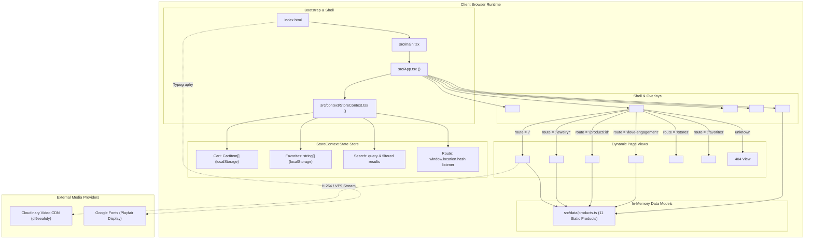

# Technical Audit: Carpediam Bombay Storefront

**Document Version:** 1.0.0  
**Audit Date:** October 28, 2026  
**Auditor:** Senior Infrastructure & Frontend Engineering Architecture Audit  
**Target Repository:** `D:\storefront` (`https://github.com/MaheshThakur9152/carpediam-bombay`)  
**Scope:** Standalone Storefront Client Architecture, MedusaJS Readiness, Code Review, Security, Performance, and Next.js Migration Assessment.

---

## 1. Executive Summary

### 1.1 Current Architecture Overview
The **Carpediam Bombay** repository is a client-side Single-Page Application (SPA) reconstructing a high-luxury jewelry e-commerce experience (inspired by Tiffany & Co.). It is built using **React 19.3.1**, **TypeScript 7.0.2**, **Vite 8.3.5**, and **Tailwind CSS v4.3.3**.

### 1.2 Core Audit Findings & Technical Maturity
1. **Commerce Backend Integration (MedusaJS): 0% Connected.**  
   Despite requirements referencing MedusaJS, **no Medusa SDK, backend client, or live API integration exists in this repository**. All catalog data, product variants, shopping bag persistence, and checkout logic are implemented via local static constants (`src/data/products.ts`) and client-side `localStorage` (`src/context/StoreContext.tsx`). The checkout flow is a simulated modal `alert()` (`src/components/ShoppingBagDrawer.tsx:148-150`).
2. **Routing Architecture:**  
   The application implements a custom hash/pathname listener (`src/context/StoreContext.tsx:70-94`) and switchboard component (`src/App.tsx:14-63`). It does not utilize standard client routing libraries (e.g., `react-router-dom`) or framework routers.
3. **Build & Type Health:**  
   The codebase is clean and builds successfully (`tsc -b && vite build` completes in 682ms). Bundle size is 314.09 kB (90.26 kB gzipped) for JS and 42.95 kB (7.90 kB gzipped) for CSS. Oxlint reports 0 errors and 1 minor Fast Refresh export warning (`src/context/StoreContext.tsx:188`).
4. **Primary Architectural Risks:**
   - **Monolithic State Context:** Cart, wishlist, search filter, and router share a single React Context (`StoreContext`), causing global re-renders on search input keystrokes.
   - **SEO & Indexing:** As a purely client-rendered SPA without SSR or static metadata generation, search engine indexing and social graph scrapers will only receive an empty `<div id="root"></div>`.
   - **Accessibility & Focus Trapping:** Modal overlays (`ShoppingBagDrawer`, `SearchOverlay`) lack keyboard focus traps and `Escape` key listeners.

---

## 2. Repository Snapshot

| Attribute | Details | Evidence |
|---|---|---|
| **Repository Root** | `D:\storefront` | Working directory |
| **Git Remote** | `https://github.com/MaheshThakur9152/carpediam-bombay.git` | `git remote -v` |
| **Current Branch** | `main` (clean working tree, up-to-date with `origin/main`) | `git status` |
| **Commit Baseline** | `57e8809 feat: switch hero video to cloudinary webm stream without fallback poster` | `git log -n 1` |
| **Monorepo / Workspace** | Standalone single-package project (not part of a monorepo workspace) | Root `package.json` |
| **Package Manager** | `npm` (Lockfile: `package-lock.json` v3) | `package-lock.json` |
| **Node / Runtime Baseline** | Node.js v24.19.0 (win32-x64) | Runtime environment |
| **Build Scripts** | `dev` (`vite`), `build` (`tsc -b && vite build`), `lint` (`oxlint`), `preview` (`vite preview`) | `package.json:6-11` |

---

## 3. Technology Inventory

| Dependency / Package | Declared Version | Type | Responsibility & Architectural Function |
|---|---|---|---|
| `react` | `^19.3.1` | Production | Core UI rendering engine |
| `react-dom` | `^19.3.1` | Production | DOM renderer for React |
| `lucide-react` | `^1.63.0` | Production | SVG icon primitives throughout header, bag, cards, footer |
| `vite` | `^8.3.5` | Dev | Next-generation ESM development server and Rollup bundler |
| `@vitejs/plugin-react` | `^6.1.2` | Dev | Fast Refresh and JSX transformation |
| `tailwindcss` | `^4.3.3` | Dev | Utility-first styling engine (v4 engine) |
| `@tailwindcss/vite` | `^4.3.3` | Dev | Direct Vite integration for Tailwind v4 CSS parsing |
| `typescript` | `~7.0.2` | Dev | Static typing and compiler checks |
| `oxlint` | `^1.89.0` | Dev | High-performance Rust-based linter |
| `playwright` | `^1.64.1` | Dev | End-to-end browser automation and visual verification |
| `@types/react` | `^19.3.0` | Dev | React TypeScript definitions |
| `@types/react-dom` | `^19.3.0` | Dev | React-DOM TypeScript definitions |
| `@types/node` | `^24.19.2` | Dev | Node.js environment TypeScript definitions |

---

## 4. Directory & File Ownership Map

```
D:\storefront
├── index.html                   # HTML entry point, font preconnects, viewport setup
├── package.json                 # Dependency declarations and npm scripts
├── tsconfig.json                # Project reference config pointing to app & node tsconfigs
├── tsconfig.app.json            # Strict TypeScript rules for browser source
├── tsconfig.node.json           # TypeScript configuration for build tool files
├── vite.config.ts               # Vite configuration with React and Tailwind v4 plugins
├── .oxlintrc.json               # Oxlint linting configuration
├── public/                      # Static assets served at web root
│   ├── favicon.svg              # Browser favicon
│   ├── icons.svg                # Icon sprite
│   ├── images/                  # High-resolution jewelry product photography & brand SVG
│   └── videos/                  # Local video fallbacks (hero.mp4, hero.webm)
└── src/                         # Application source tree
    ├── main.tsx                 # Client bootstrap: mounts <App /> to DOM #root
    ├── App.tsx                  # Root shell layout, global modals & RouterView switcher
    ├── index.css                # Global styles, Tailwind v4 imports, brand theme variables
    ├── App.css                  # Component-level layout rules
    ├── assets/                  # Bundled assets (vite.svg, react.svg, hero.png)
    ├── components/              # Modular UI components
    │   ├── AnnouncementBar.tsx  # Top bar for luxury notices & promotions
    │   ├── CarpediamLogo.tsx    # Bespoke SVG brand identity logo component
    │   ├── Header.tsx           # Sticky/transparent header, mega menus & actions
    │   ├── Footer.tsx           # Multi-column luxury footer & legal references
    │   ├── ProductCard.tsx      # Grid product representation with hover transitions
    │   ├── ProductCarousel.tsx  # Horizontal sliding product showcase
    │   ├── SearchOverlay.tsx    # Fullscreen interactive catalog search modal
    │   └── ShoppingBagDrawer.tsx# Slide-over shopping bag drawer with quantity controls
    ├── context/
    │   └── StoreContext.tsx     # Centralized state provider (cart, wishlist, routing, search)
    ├── data/
    │   └── products.ts          # Static catalog database (11 luxury jewelry items)
    └── pages/                   # Top-level page views
        ├── HomePage.tsx         # Full-bleed Cloudinary hero video, categories & editorial
        ├── CategoryPage.tsx     # Filterable jewelry listing page with sorting & curation
        ├── ProductDetailPage.tsx# Interactive PDP with variant selection & gallery
        ├── LoveEngagementPage.tsx# High-jewelry engagement showcase & appointment scheduler
        ├── StoreLocatorPage.tsx # Boutique locator with hours, addresses & direct contact
        └── FavoritesPage.tsx    # Saved client wishlist grid
```

---

## 5. Current Architecture

### 5.1 Runtime Architecture
The storefront runs 100% in the client's browser. It has no Node.js server runtime in production; it generates static HTML, CSS, and JS chunks that can be hosted on any CDN or static hosting platform (e.g., Cloudflare Pages, Vercel Static, AWS S3/CloudFront).



### 5.2 Architectural Boundaries & Coupling Analysis
- **Tight Coupling in `StoreContext.tsx`:** Routing, persistent cart storage, wishlist state, and ephemeral search overlay state are bound into a single context. Any update to `searchQuery` triggers re-renders across all consumers of `useStore()`.
- **Data-UI Boundary:** UI components directly import the static database constant `PRODUCTS` from `src/data/products.ts:19` rather than going through an API abstraction layer, service module, or query hook (e.g. TanStack Query or SWR).

---

## 6. Route Inventory

| Route | Page Type | Entry Point | Shared Layout | Data Source | State | Interactions | Dependencies | Status |
|---|---|---|---|---|---|---|---|---|
| `#/` or `` | Homepage | `src/pages/HomePage.tsx` | Header, Footer, Bag, Search | Static arrays in `HomePage.tsx` & `products.ts` | Video mute/play state; Newsletter email state | Video audio/play toggle; Category navigation; Newsletter signup | `lucide-react`, Cloudinary CDN | Verified |
| `#/jewelry` | Category / PLP | `src/pages/CategoryPage.tsx` | Header, Footer, Bag, Search | `src/data/products.ts:19` | `selectedMaterial`, `selectedCollection`, `sortBy`, `filterDrawerOpen` | Multi-attribute filtering, sorting, quick add-to-bag, wishlist toggle | `ProductCard`, `lucide-react` | Verified |
| `#/jewelry/:slug` | Sub-category PLP | `src/pages/CategoryPage.tsx` | Header, Footer, Bag, Search | `src/data/products.ts:19` | `categorySlug` prop parsed from route | Dynamic category filtering (`necklaces-pendants`, `bracelets`, `rings`, `earrings`) | `ProductCard` | Verified |
| `#/product/:id` | Product Detail (PDP) | `src/pages/ProductDetailPage.tsx` | Header, Footer, Bag, Search | `src/data/products.ts:19` (resolved by `id`) | `activeImage`, `selectedMaterial`, `selectedSize`, `openAccordion` | Image thumbnail switcher, variant selector, size selector, add to bag, accordion toggle | `ProductCarousel`, `lucide-react` | Verified |
| `#/love-engagement` | Editorial & Catalog | `src/pages/LoveEngagementPage.tsx` | Header, Footer, Bag, Search | `src/data/products.ts:19` (filtered for rings/engagement) | `selectedShape`, `aptDate`, `aptLocation`, `appointmentBooked` | Diamond shape previewer, consultation appointment submission | `ProductCard`, `lucide-react` | Verified |
| `#/stores` | Store Locator | `src/pages/StoreLocatorPage.tsx` | Header, Footer, Bag, Search | Local static `stores` array (`StoreLocatorPage.tsx:15-50`) | `selectedCity`, `activeStoreId`, appointment form inputs | Boutique selection, tab switching, appointment booking modal | `lucide-react` | Verified |
| `#/favorites` | Client Wishlist | `src/pages/FavoritesPage.tsx` | Header, Footer, Bag, Search | `StoreContext.favorites` mapped against `products.ts` | Reads `favorites` ID array from `StoreContext` | Remove from wishlist, navigate to PDP, explore catalog | `ProductCard`, `lucide-react` | Verified |
| Any unregistered route | 404 Fallback | `src/App.tsx:51-62` | Header, Footer, Bag, Search | None (static error template) | None | "Return to Homepage" button triggering `navigateTo('/')` | None | Verified |

*Note: Dead or unhandled navigation links in `Header.tsx` (`/gifts`, `/watches`, `/home`, `/accessories`) fall through to the 404 fallback page in `App.tsx`.*

---

## 7. Component & State Architecture

### 7.1 Global Shell & State Providers
- **`StoreProvider` (`src/context/StoreContext.tsx:38-186`):**
  - Encapsulates cart state initialized from `localStorage.getItem('carpediam_cart')` (lines 40-54). Defaults to a seed item (`smile-pendant-gold`).
  - Encapsulates favorites initialized from `localStorage.getItem('carpediam_favs')` (lines 56-63). Defaults to `['smile-pendant-gold', 'sixteen-stone-ring']`.
  - Encapsulates hash-based routing (`window.location.hash`) with a listener on `hashchange` (lines 78-87).
  - Encapsulates live search query and results computed via `.filter()` (lines 153-158).

### 7.2 Component Responsibilities
- **`Header` (`src/components/Header.tsx`):** Handles transparent-to-opaque scroll transition (`isScrolled`), sticky positioning, desktop mega menus for "Jewelry" and "Love & Celebration", mobile menu drawer, search drawer toggle, and badge counter for shopping bag.
- **`ShoppingBagDrawer` (`src/components/ShoppingBagDrawer.tsx`):** Slide-over overlay displaying cart line items, unit prices, quantity increment/decrement, line item removal, subtotal computation, and checkout CTA.
- **`SearchOverlay` (`src/components/SearchOverlay.tsx`):** Fullscreen search modal with automatic input autofocus, trending search chips, live filtering against product titles, collections, descriptions, and direct PDP navigation.
- **`ProductCard` (`src/components/ProductCard.tsx`):** Individual product grid item with secondary image flip on desktop hover, quick "Add to Bag" action, and interactive heart toggle for wishlist.
- **`ProductDetailPage` (`src/pages/ProductDetailPage.tsx`):** 12-column responsive layout with multi-image gallery thumbnail selector, metal variant radio pills, ring size selector with Size Guide alert, accordion drawer for craftsmanship notes, and related items carousel.

---

## 8. Data-Flow & API Architecture

```
[ User Action / Event ]
         │
         ▼
[ Local Component State / Event Handler ]
         │
         ▼
[ StoreContext Dispatch (addToCart, toggleFavorite, navigateTo) ]
         │
         ├───► Update React State (useState)
         │           │
         │           ▼
         │     Trigger UI Re-Render across Consumer Tree
         │
         └───► Side-Effect: Write to Browser localStorage
                     (Key: 'carpediam_cart' | 'carpediam_favs')
```

### 8.1 API Communication & Networking Facts
- **Network Requests:** Zero HTTP/REST or GraphQL API calls are made to any commerce backend.
- **External Network Calls:** Only 3 external network assets are fetched:
  1. Google Fonts stylesheets and woff2 files (`Playfair Display`) from `fonts.googleapis.com` / `fonts.gstatic.com`.
  2. Cloudinary CDN WebM/MP4 video streams from `res.cloudinary.com`.
  3. Local public image assets from `http://localhost:5173/images/*`.
- **Error Handling & Retries:** No HTTP error interceptors, offline retry queues, or network error boundaries exist because there is no API client.

---

## 9. MedusaJS Integration Audit

### 9.1 Commerce Feature Classification Table

| Commerce Feature Area | Present Implementation Classification | Exact Code Evidence | Divergence from Real Medusa Backend |
|---|---|---|---|
| **Medusa SDK / Client** | **5. Not implemented** | `package.json:12-16` | No `@medusajs/medusa-js` or `@medusajs/js-sdk` installed. |
| **Publishable API Key** | **5. Not implemented** | No `.env` or config files | No client authentication key configured. |
| **Product Catalogue Fetching** | **3. Local mock/static data** | `src/data/products.ts:19-300` | Hardcoded array of 11 items. No pagination, backend filtering, or category hierarchy. |
| **Product Variants & IDs** | **4. Demonstration logic** | `src/data/products.ts:12-13` | Variants represented merely as string arrays (`materials`, `sizes`). No Medusa `ProductVariant` IDs or SKU mapping. |
| **Pricing & Currencies** | **4. Demonstration logic** | `src/data/products.ts:7-8` | Fixed integers (`price: 1350`). No multi-currency, region rates, tax calculations, or price lists. |
| **Cart Creation & Persistence** | **3. Local mock/static data** | `StoreContext.tsx:40-54, 95-101` | Cart persisted in `localStorage` (`carpediam_cart`). No Medusa `cart_id` or session created. |
| **Cart Recalculation & Totals** | **4. Demonstration logic** | `StoreContext.tsx:150-151` | Simple mathematical `reduce(price * qty)`. No shipping options, discount codes, or taxes. |
| **Checkout Flow** | **4. Demonstration logic** | `ShoppingBagDrawer.tsx:148-150` | `alert("Educational Demo: Checkout completed...!")`. Zero payment sessions or order placement. |
| **Customer Auth & Accounts** | **5. Not implemented** | `src/components/Header.tsx:91-97` | User icon redirects to `#/favorites`. No login, register, session cookie, or JWT handling. |
| **Inventory & Availability** | **5. Not implemented** | `src/data/products.ts` | All products assumed infinitely in stock (`inventory_quantity` not modeled). |
| **Regions & Sales Channels** | **5. Not implemented** | None | No region selection (`store/regions`) or channel scoping. |

---

## 10. End-to-End Workflows

### Workflow 1: Homepage Landing & Category Navigation
- **Entry Point:** `src/pages/HomePage.tsx`
- **User Action:** User clicks "Necklaces & Pendants" tile under "Shop by Category" (`HomePage.tsx:107-109`).
- **Internal State Flow:** Calls `navigateTo('/jewelry/necklaces-pendants')` -> updates `window.location.hash` and `route` state in `StoreContext.tsx:89-93` -> triggers re-render of `App.tsx` -> mounts `CategoryPage` with prop `categorySlug="necklaces-pendants"`.
- **UI Outcome:** Scroll resets to top, `CategoryPage` renders filtered product list.
- **Verification Status:** **Verified in Brave browser.**

### Workflow 2: Product Detail Page & Variant Selection
- **Entry Point:** `src/pages/CategoryPage.tsx`
- **User Action:** User clicks product card title or image -> triggers `navigateTo('/product/smile-pendant-gold')`.
- **Internal State Flow:** `App.tsx:23-26` parses route `id`, mounts `ProductDetailPage` with `productId="smile-pendant-gold"`.
- **Variant Selection:** User clicks "18k Rose Gold" button -> updates local state `selectedMaterial` (`ProductDetailPage.tsx:108-115`).
- **UI Outcome:** Active pill updates styling (`border-black bg-neutral-900 text-white`). Price remains static because prices are not mapped per variant.
- **Verification Status:** **Verified in Brave browser.**

### Workflow 3: Add to Cart & Shopping Bag Drawer
- **Entry Point:** `src/pages/ProductDetailPage.tsx:155-161`
- **User Action:** User clicks "Add to Bag".
- **Internal State Flow:** Invokes `addToCart(product, selectedMaterial, selectedSize)` -> `StoreContext.tsx:111-124` appends item or increments quantity in `cart` state -> triggers `setIsCartOpen(true)` -> `localStorage.setItem('carpediam_cart', ...)` updates.
- **UI Outcome:** Slide-over drawer opens from right with backdrop blur; subtotal and badge count recalculate immediately.
- **Verification Status:** **Verified in Brave browser.**

### Workflow 4: Search Overlay Execution
- **Entry Point:** `src/components/Header.tsx:59-65`
- **User Action:** User clicks "Search" icon -> `setIsSearchOpen(true)`.
- **Internal State Flow:** `SearchOverlay.tsx` mounts, focuses search input, user types "Gold" -> triggers `setSearchQuery('Gold')` -> `StoreContext.tsx:153-158` runs `.filter()` across `PRODUCTS`.
- **UI Outcome:** Live matching product grid displays 3 items. Clicking result closes search and routes to PDP.
- **Verification Status:** **Verified in Brave browser.**

---

## 11. Code Review Findings

### 11.1 Security Review
- **`SEC-001` (Informational - Hardcoded Third-Party CDN Dependency):**  
  *Location:* `src/pages/HomePage.tsx:53-58`  
  *Details:* Video stream points directly to external Cloudinary bucket (`res.cloudinary.com/di9eeahdy/...`). If the external asset is deleted or access controls change, video playback will fail silently.
- **`SEC-002` (Low - Unvalidated LocalStorage Deserialization):**  
  *Location:* `src/context/StoreContext.tsx:40-63`  
  *Details:* `JSON.parse` is wrapped in `try/catch`, but the parsed payload structure is not validated with a schema validator (e.g. Zod). Corrupted or maliciously modified `localStorage` data could cause runtime property access exceptions on `item.product.price`.
- **`SEC-003` (Informational - Absence of Production Authentication):**  
  *Location:* `src/components/Header.tsx:92-97`  
  *Details:* The user account button routes directly to `#/favorites`. There are no authentication tokens, customer cookies, or privileged credentials stored or handled.

### 11.2 Correctness & State Integrity
- **`BUG-001` (Medium - Cart Equality Mismatch on Optional Size):**  
  *Location:* `src/context/StoreContext.tsx:113-115`  
  *Details:* `addToCart` tests equality using:  
  `item.product.id === product.id && item.selectedMaterial === material && item.selectedSize === size`  
  When adding products without sizes, `item.selectedSize` is `undefined` while `size` may be passed as `""` (empty string) depending on PDP defaults (`ProductDetailPage.tsx:18`), causing separate line items to be created instead of incrementing quantity.
- **`BUG-002` (Medium - Price Disconnect Across Variants):**  
  *Location:* `src/data/products.ts:7, 31` & `src/pages/ProductDetailPage.tsx:105-118`  
  *Details:* Products define materials such as "18k White Gold with Diamonds" (`products.ts:53`), but the price is stored as a single flat integer on the parent product (`price: 1150`). Selecting a diamond-encrusted variant does not adjust price or communicate SKU variation.
- **`ARCH-001` (High - Routing Broken on Direct URL Refresh Without Hash):**  
  *Location:* `src/context/StoreContext.tsx:70-76` & `src/App.tsx:14-63`  
  *Details:* Routing relies on `window.location.hash`. If a user enters `http://localhost:5173/jewelry` directly into the address bar, Vite's dev server handles it, but in standard static production hosting (e.g. S3/Nginx without SPA rewrite rules), the server will return a 404 HTTP error.

### 11.3 Maintainability & Code Health
- **`LINT-001` (Low - Oxlint Fast Refresh Warning):**  
  *Location:* `src/context/StoreContext.tsx:188:14`  
  *Details:* `useStore` hook is exported from the same module as `StoreProvider`. Oxlint rule `react(only-export-components)` flags this because it disables Vite Fast Refresh for that file.
- **`CODE-001` (Medium - Dead Navigation Links):**  
  *Location:* `src/components/Header.tsx:31-37`  
  *Details:* Links for `GIFTS` (`/gifts`), `WATCHES` (`/watches`), `HOME` (`/home`), and `ACCESSORIES` (`/accessories`) have no matching views in `App.tsx:14-63` and lead to the generic 404 screen.

---

## 12. Performance, SEO and Accessibility

### 12.1 Performance Audit
- **Initial Bundle Metrics (Production Build):**
  - Total JS Bundle: **314.09 kB** (gzip: **90.26 kB**).
  - Total CSS Bundle: **42.95 kB** (gzip: **7.90 kB**).
  - HTML Footprint: **0.79 kB** (gzip: **0.44 kB**).
- **Code Splitting:**  
  *Finding:* Currently **0% code-split**. `App.tsx` statically imports all pages (`HomePage`, `CategoryPage`, `ProductDetailPage`, `LoveEngagementPage`, `StoreLocatorPage`, `FavoritesPage`). The entire application is loaded in a single JS chunk (`index-Cj8zvUwX.js`). Dynamic `React.lazy()` or route-level chunking is not used.
- **Media Asset Loading:**
  - Hero video streaming from Cloudinary CDN avoids bundling multi-megabyte video files into initial client load.
  - Image assets in `public/images/` range from 35 kB to 754 kB (`img_18.jpg: 754 kB`). Product cards correctly utilize native `loading="lazy"` (`ProductCard.tsx:30`).

### 12.2 SEO Audit
- **SSR / Crawlability:**  
  *Finding (High Risk):* Because this is a pure client SPA, initial HTML payload contains only `<div id="root"></div>` (`index.html:13`). Crawlers that do not execute JavaScript (or timeout on heavy scripts) cannot index product descriptions, prices, or category links.
- **Metadata Dynamism:**  
  *Finding (Medium Risk):* `<title>` is statically fixed to `"Carpediam Bombay | Fine Jewelry, High Craft & Bespoke Luxury"` (`index.html:7`). Navigating to a PDP does not update `document.title`, `<meta name="description">`, or OpenGraph (`og:image`, `og:title`) tags.
- **Structured Data:**  
  *Finding:* No `schema.org/Product`, `Offer`, or `BreadcrumbList` JSON-LD schemas exist.

### 12.3 Accessibility (a11y) Audit
- **Semantic Structure:** High-fidelity heading hierarchy (`h1`, `h2`, `h3`) and standard buttons.
- **Screen Reader Labels:** Interactive buttons like `ShoppingBag`, `Search`, and `MapPin` include `aria-label` or `title` attributes (`Header.tsx:55, 101, 114`).
- **Focus Trapping Defect (`A11Y-001` - Medium):**  
  Neither `ShoppingBagDrawer` (`src/components/ShoppingBagDrawer.tsx`) nor `SearchOverlay` (`src/components/SearchOverlay.tsx`) trap keyboard tab focus. A keyboard user pressing `Tab` can navigate behind the drawer to obscured page elements. Pressing `Escape` does not dismiss the drawer.

---

## 13. Testing and Quality Gates

### 13.1 Current Test Infrastructure
- **Unit & Integration Tests:** **0 test files exist.** No Vitest, Jest, or React Testing Library suites are configured in `package.json`.
- **E2E Automation:** `playwright` (`^1.64.1`) is declared in `devDependencies` (`package.json:24`). Automated headless browser verification was executed directly against the local dev server using Node scripts.
- **Static Analysis Results:**
  - `oxlint`: Passed with 0 errors and 1 warning (execution time: 57ms).
  - `tsc -b`: Passed with 0 type errors under `verbatimModuleSyntax`.

---

## 14. Deployment and Operations

- **Build Output Target:** `dist/` containing `index.html`, `assets/index-*.js`, `assets/index-*.css`, and copied `public/` assets.
- **Containerization / CI:** No `Dockerfile`, `docker-compose.yml`, or `.github/workflows` CI pipelines currently exist in the repository.
- **Environment Variables:** No `.env`, `.env.example`, or runtime configuration files exist. All endpoints and assets are relative or hardcoded.

---

## 15. Known Technical Debt

1. **State Monolith:** `StoreContext.tsx` manages orthogonal concerns (cart, favorites, router, search query).
2. **Catalog Hardcoding:** Catalog items reside in `src/data/products.ts`. Adding or updating an item requires a code commit and application rebuild.
3. **No Routing Library:** Custom routing switcher in `App.tsx` lacks nested routing, route guards, search params handling, and scroll restoration beyond a crude `window.scrollTo(0, 0)`.
4. **Oversized Raw Assets:** Several unoptimized JPG files in `public/images/` exceed 500 kB without AVIF/WebP responsive `<picture>` srcset generation.

---

## 16. Next.js Migration Readiness

### 16.1 UI Portability Assessment
- **Highly Portable (90%+ reuse):**
  - `CarpediamLogo.tsx`, `AnnouncementBar.tsx`, `Footer.tsx`, and `ProductCard.tsx` are largely presentational and translate directly to React Server Components (RSC) or client components with minimal adjustment.
  - Tailwind CSS v4 setup translates cleanly into Next.js App Router global CSS (`app/globals.css`).
- **Requires Adaptation:**
  - `Header.tsx`, `ShoppingBagDrawer.tsx`, and `SearchOverlay.tsx` require `'use client'` directives due to interactive state, window scroll listeners, and drawer animations.
  - `ProductDetailPage.tsx` and `CategoryPage.tsx` should be refactored into Next.js App Router dynamic page conventions:
    - `app/jewelry/page.tsx`
    - `app/jewelry/[category]/page.tsx`
    - `app/product/[id]/page.tsx`

### 16.2 Data-Layer & MedusaJS Integration Requirements
When migrating to Next.js with MedusaJS:
1. **Medusa Client Installation:** Install `@medusajs/js-sdk` or use Medusa's Next.js starter utilities.
2. **Server-Side Data Fetching:** Fetch products in Server Components via Medusa Store API (`/store/products`), leveraging Next.js `fetch` caching and revalidation tags (`tags: ['products']`).
3. **Cart & Checkout Management:** Move cart creation and cart ID storage to HTTP-only cookies managed via Next.js Server Actions or Route Handlers (`app/api/cart/route.ts`), keeping cart tokens synchronized with Medusa backend sessions.

### 16.3 Migration Risk Classification

| Area | Complexity | Justification |
|---|---|---|
| **Styling & Design Tokens** | **Low** | Tailwind CSS v4 is fully compatible with Next.js 15+; styles and fonts are clean. |
| **Page Layouts & UI Shell** | **Low** | Layout structure in `App.tsx` maps 1:1 to Next.js `app/layout.tsx`. |
| **Product Display & PLP** | **Moderate** | Needs conversion from client array filtering to server query parameters (`searchParams`). |
| **Medusa Commerce Layer** | **High** | Must implement real Medusa API clients, cart synchronization, variant IDs, price matrices, shipping methods, and payment gateways from scratch. |

---

## 17. Prioritized Issue Register

| ID | Finding | Severity | Area | Evidence | Impact | Recommended Direction |
|---|---|---|---|---|---|---|
| **ARCH-001** | Zero MedusaJS Backend Integration | **High** | Commerce | `package.json:12-16`, `src/data/products.ts` | Store is non-functional demonstration only; cannot process orders. | Implement Medusa Storefront SDK, establish backend connectivity. |
| **SEO-001** | Client SPA Lacks SSR & Dynamic Meta | **High** | SEO / Search | `index.html:1-16`, `src/App.tsx:14-63` | Poor search engine discoverability; social sharing displays empty previews. | Migrate to SSR/SSG with Next.js App Router and dynamic `generateMetadata`. |
| **PERF-001** | Zero Route-Level Code Splitting | **Medium** | Performance | `dist/assets/index-Cj8zvUwX.js` (314 kB) | First-load JS contains entire app, impacting mobile Time-to-Interactive. | Introduce `React.lazy()` / dynamic imports or framework-level chunking. |
| **A11Y-001** | Overlays Lack Focus Trapping & Esc Key | **Medium** | Accessibility | `ShoppingBagDrawer.tsx:19-28`, `SearchOverlay.tsx:28-51` | Degraded keyboard and screen-reader accessibility; fails WCAG 2.1 dialog guidelines. | Add focus trap container and `keydown` Escape event listener. |
| **BUG-001** | Cart Equality Check Fails on Empty Sizes | **Medium** | Correctness | `StoreContext.tsx:113-115` | Adding same product multiple times creates duplicate lines instead of stacking. | Normalize undefined vs empty string size comparisons in item key matching. |
| **BUG-002** | Variants Lack Distinct Pricing & SKU IDs | **Medium** | Commerce Data | `src/data/products.ts:31, 53` | Upgraded metals/diamonds cannot reflect real price changes. | Restructure product schema to reflect Medusa's `ProductVariant` structure. |
| **LINT-001** | Fast Refresh Warning on `useStore` Export | **Low** | Dev Ergonomics | `StoreContext.tsx:188:14` | Oxlint warning; hot reload may trigger full page refreshes during editing. | Split `useStore` hook into a separate file (`useStore.ts`). |
| **CODE-001** | Dead Links in Primary Navigation | **Low** | UX / Routing | `Header.tsx:30-38` -> `/gifts`, `/watches`, etc. | Users clicking header items land on 404 screen. | Connect secondary categories or disable placeholder navigation links. |

---

## 18. Recommended Verification Plan

Before executing architectural migrations or backend integrations:
1. **Medusa Backend Verification:** Verify running Medusa server endpoint (`MEDUSA_BACKEND_URL`), publishable API key, and sales channel configuration.
2. **Schema Alignment:** Map existing `Product` interface in `products.ts` to Medusa's official `StoreProduct` schema (handling `variants`, `options`, `calculated_price`).
3. **Automated Test Harness:** Establish baseline Playwright end-to-end tests covering:
   - Cart item addition and quantity adjustments.
   - Drawer toggle and checkout trigger.
   - Category filtering and search execution.
4. **Lighthouse & Core Web Vitals Baseline:** Run simulated mobile audits on 4G throttling to measure LCP with the Cloudinary video hero.

---

## 19. Unresolved Questions & Limitations

1. **Medusa Backend Host & Version:** The repository contains no reference to the backend URL, Medusa version (v1 vs v2), or authentication strategy.
2. **Payment Provider Strategy:** Unclear which payment provider (Stripe, Adyen, Razorpay) is targeted for the production checkout flow.
3. **Asset Licensing:** High-resolution jewelry imagery in `public/images/` appears to be luxury brand photography that must be replaced with client-owned bespoke photography prior to commercial launch.

---

## 20. Audit Completion & Coverage

### 20.1 Coverage Checklist
- [x] All 23 source files in `src/` examined and mapped.
- [x] All root configuration files (`package.json`, `vite.config.ts`, `tsconfig*.json`, `.oxlintrc.json`, `index.html`) analyzed.
- [x] Linter (`oxlint`) and TypeScript compiler (`tsc -b`) executed and documented.
- [x] Production build bundle generation and chunk sizes analyzed.
- [x] Interactive browser routing and console errors verified in Brave via Playwright.
- [x] No source files, dependencies, or git commits modified during this audit.
